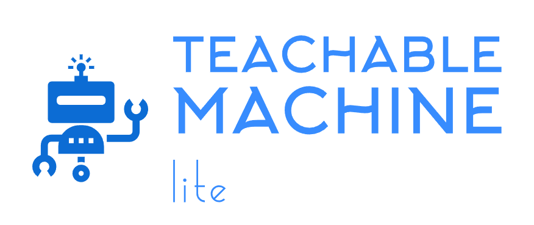

# Teachable Machine Lite { .tm-title }

<div class="tm-hero" markdown>



**Run your Google Teachable Machine image models on Raspberry Pi, robots and other edge devices.**
A few lines of Python, powered by LiteRT, with no TensorFlow required.

[Get started](getting-started/quickstart.md){ .md-button .md-button--primary }
[Browse examples](examples/index.md){ .md-button }

</div>

```bash
pip install teachable-machine-lite
```

```python
from teachable_machine_lite import TeachableMachineLite

model = TeachableMachineLite(model_path="model.tflite", labels_file_path="labels.txt")
result = model.classify_image("photo.jpg")

print(result["label"], result["confidence"])
```

## From idea to device

<div class="grid cards" markdown>

-   :material-school:{ .lg } **[1. Train](getting-started/export-model.md)**

    ---

    Train an image model in [Teachable Machine](https://teachablemachine.withgoogle.com/), with no coding.

-   :material-download:{ .lg } **[2. Export](getting-started/export-model.md)**

    ---

    Download it as a TensorFlow Lite model, quantized or floating point, with its `labels.txt`.

-   :material-play-circle:{ .lg } **[3. Run](getting-started/quickstart.md)**

    ---

    Pass it a camera frame or an image file and get back the class and its confidence.

</div>

## Why Teachable Machine Lite

<div class="grid cards" markdown>

-   :material-feather:{ .lg } **Lightweight**

    Runs on LiteRT (formerly TensorFlow Lite) instead of the full TensorFlow.

-   :material-robot:{ .lg } **[Built for edge computing](guides/performance.md)**

    Runs your model on the device itself, for robots and other low-power hardware such as Raspberry Pi.

-   :material-image-outline:{ .lg } **[Takes frames directly](guides/images-and-frames.md)**

    Pass OpenCV or Picamera2 frames, PIL images or file paths. No need to save frames first.

-   :material-code-json:{ .lg } **[Plain results](reference/results.md)**

    Results are ordinary Python values, so you can compare them, log them or send them as JSON.

</div>

!!! tip "Need to use a Keras `.h5` model?"

    Use the [Teachable Machine](https://meqdaddev.github.io/teachable-machine/) package,
    which runs on the full TensorFlow.
