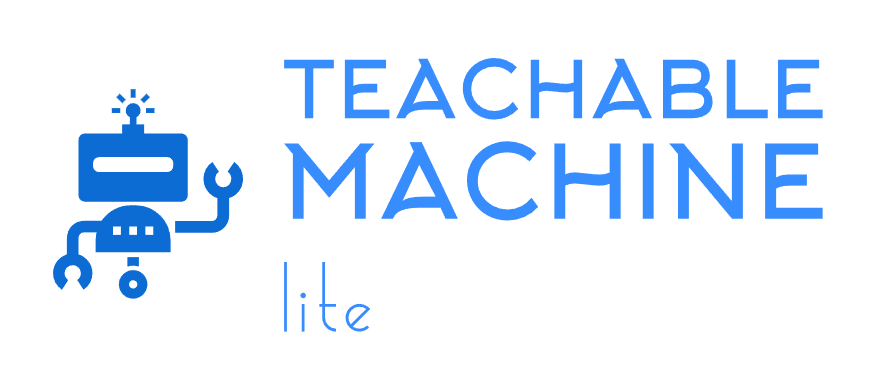

# Welcome to Teachable Machine Lite Package
_By: [Meqdad Darwish](https://github.com/MeqdadDev)_

<picture>
  
</picture>

## Description

**Run your Google Teachable Machine image models on Raspberry Pi, robots and other edge devices in a few lines of Python. Lightweight, powered by LiteRT, no TensorFlow required.**

Teachable Machine Lite lets you take an image model you trained in Google's [Teachable Machine](https://teachablemachine.withgoogle.com/), with no coding needed, and run it on a Raspberry Pi, a robot, or any small computer with just a few lines of Python. It runs on LiteRT (formerly TensorFlow Lite) instead of the full TensorFlow, so it installs quickly, starts fast and works comfortably on resource-constrained hardware. Pass it a camera frame from OpenCV or Picamera2 and get back the predicted class and its confidence, ready to draw on the image or act on. That makes it a good fit for robotics, IoT and other edge AI projects. It's the lightweight sibling of the [Teachable Machine](https://github.com/MeqdadDev/teachable-machine) package.

Source Code is published on [GitHub](https://github.com/MeqdadDev/teachable-machine-lite)

## Table Of Contents

1. [How-To Guide](how-to-guide.md)
2. [Requirements](requirements.md)
3. [Code Examples](codeExamples.md)
4. [Explanation](explanation.md)
5. [Changelog](changelog.md)
6. [Contributing](contribution.md)
7. [Releasing](releasing.md)

## Supported Classifiers

**Image Classification**: Use an exported TensorFlow Lite model from [Teachable Machine Platform](https://teachablemachine.withgoogle.com/) (a model file with `tflite` extension). Both the **Quantized** and the **Floating point** exports are supported.

Works on Raspberry Pi OS (64-bit recommended), Linux, Windows and macOS, with NumPy 1.x or 2.x.

## Links

- [PyPI](https://pypi.org/project/teachable-machine-lite/)

- [Source Code](https://github.com/MeqdadDev/teachable-machine-lite)

- [Teachable Machine Platform](https://teachablemachine.withgoogle.com/)
